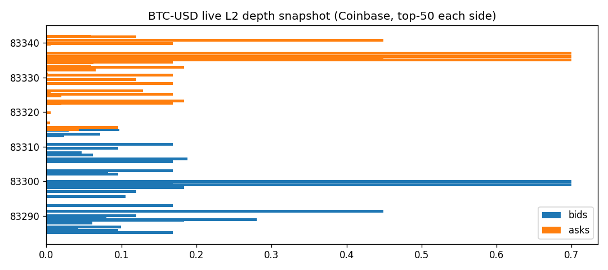
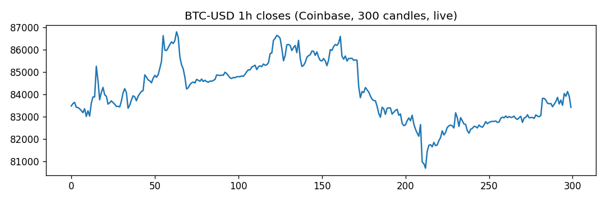
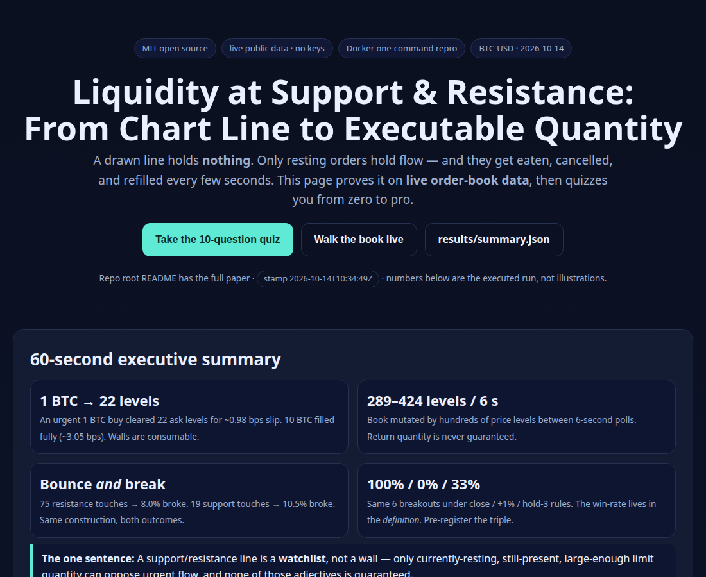
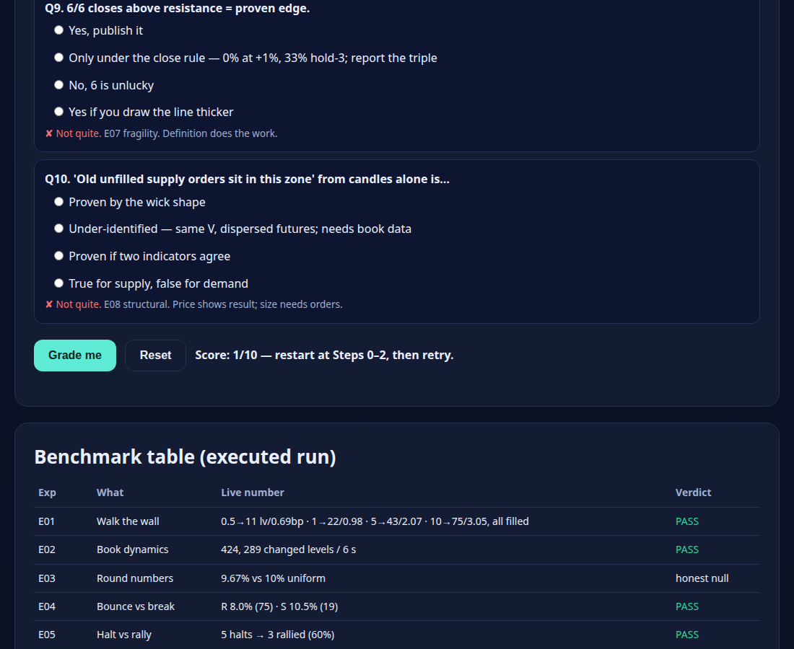

# Liquidity at Support & Resistance: From Chart Line to Executable Quantity

[](LICENSE)
[](src/run_all.py)
[](docker-compose.yml)
[](results/summary.json)
[](https://m0-ar.github.io/liquidity-support-resistance-verify-2026/)

> **Live interactive website (click):** **https://m0-ar.github.io/liquidity-support-resistance-verify-2026/** · mirrors: [`/preview.html`](https://m0-ar.github.io/liquidity-support-resistance-verify-2026/preview.html) · [`/docs/preview.html`](https://m0-ar.github.io/liquidity-support-resistance-verify-2026/docs/preview.html) (all three resolve — see [§4](#4-live-website--github-pages-2026)). Local file: [`docs/preview.html`](docs/preview.html) · root mirror: [`preview.html`](preview.html).

**One-line pitch:** an open-source, fully reproducible benchmark that proves — on **live public order-book data, no API keys** — that a drawn support/resistance line is not liquidity, only executable resting orders are.

---

## 0. CEO summary — read this in 60 seconds

1. **Lines don't hold prices. Orders do.** Drawing support/resistance adds zero orders to the market.
2. **Walls get eaten.** A visible 10 BTC sell wall filled completely for ~3 bps slip; books mutate by hundreds of levels every 6 seconds.
3. **Same level, both outcomes.** Identically defined touches bounced 90%+ of the time *and* broke 8–10% — there is no symmetry guarantee.
4. **A halt is not a rally.** Only 60% of support halts earned follow-through; rallies need fresh prints at higher prices.
5. **Breakout win-rate lives in the definition.** The same 6 breakouts score **100% / 0% / 33%** when you change one sentence in the rule. Report the full surface or report nothing.
6. **Price alone cannot prove "old unfilled orders."** Same candle shape, dispersed futures — microstructure claims need order data.
7. **One command reproduces everything:** `docker compose up research`. Public data, pre-registered rules, null models, honest negatives.

If you only open one more file, open [`docs/preview.html`](docs/preview.html) — it teaches all of this with pictures and a graded quiz, zero to pro.

---

## Table of contents

- [0. CEO summary](#0-ceo-summary--read-this-in-60-seconds)
- [1. Demo (see it working)](#1-demo-see-it-working)
- [2. Features](#2-features)
- [3. Who is this for (user stories)](#3-who-is-this-for-user-stories)
- [🌱 Beginner guide — read this and you are a professional](#-beginner-guide--read-this-and-you-are-a-professional)
- [4. Live website / GitHub Pages 2026](#4-live-website--github-pages-2026)
- [5. Quickstart (3 steps, copy-paste)](#5-quickstart-3-steps-copy-paste)
- [6. What you will learn (quiz + answers)](#6-what-you-will-learn-quiz--answers)
- [7. Full research paper (all original detail, kept)](#7-full-research-paper-all-original-detail-kept)
- [8. FAQ](#8-faq)
- [9. Contributing / Citation / License / Support](#9-contributing--citation--license--support)

---

## 1. Demo (see it working)

### Screenshots (generated, committed)

| Live L2 depth (Coinbase BTC-USD, top-50 each side) | 1h closes (300 candles, live) |
|---|---|
|  |  |

| Interactive site — hero + KPIs | Quiz graded live (Playwright-verified, zero console errors) |
|---|---|
|  |  |

> Figures are rendered by `src/run_all.py` only — never hand-drawn. Re-run to refresh. Site shots by `docs/record_preview.py` (Playwright, verified no console errors); full page at `docs/screenshots/preview_full.png`.

### Terminal demo (reproducible GIF path)

GitHub READMEs render GIFs inline and autoplay them; they strip raw `<video>` tags. So the pro path is: **record → GIF (<8 MB) → commit → embed**. Two supported recorders:

**Option A — terminal (this repo's benchmark):**
```bash
# docs/demo.tape is committed; regenerate anytime with vhs (https://github.com/charmbracelet/vhs)
# vhs docs/demo.tape   # -> docs/demo.gif
python3 src/run_all.py
```
Embed (already wired for `docs/demo.gif` once you render it):
```md

```

**Option B — browser (the interactive site):** a Playwright script is committed at `docs/record_preview.py`. It opens `docs/preview.html`, clicks through the quiz, screenshots each stage, and stitches a GIF/MP4 if `ffmpeg` is present:
```bash
python3 docs/record_preview.py   # -> docs/preview_shots/*.png (+ preview.gif if ffmpeg)
```

**Option C — asciinema (terminal player, no GIF weight):**
```bash
asciinema rec docs/demo.cast -c "python3 src/run_all.py"
# share the cast, then link its SVG preview in README (asciinema Share → preview-link snippet)
```

Full recorder notes live in [`docs/DEMO.md`](docs/DEMO.md).

### Interactive demo (the website)

[](https://m0-ar.github.io/liquidity-support-resistance-verify-2026/)

Live: [`/`](https://m0-ar.github.io/liquidity-support-resistance-verify-2026/) · [`/preview.html`](https://m0-ar.github.io/liquidity-support-resistance-verify-2026/preview.html) · [`/docs/preview.html`](https://m0-ar.github.io/liquidity-support-resistance-verify-2026/docs/preview.html) · local: [`docs/preview.html`](docs/preview.html) · [`preview.html`](preview.html)

`docs/preview.html` (canonical; mirrored at root `preview.html`) is a dependency-free static page: depth chart (SVG, from live numbers), walk-the-book slider, touch/break explorer, triple-definition switcher (100%/0%/33%), and a **10-question graded quiz** with explanations. Works from `file://`, works on GitHub Pages, no build step.

---

## 2. Features

| Feature | What it does | Where |
|---|---|---|
| Live L2 benchmark, no keys | Fetches Coinbase book + candles, archives raw JSON with UTC stamp | `src/common.py`, `src/run_all.py` |
| Walk-the-book simulator | Urgent qty → avg/worst price, levels used, slip (bps), unfilled | `src/experiments.py` → E01 |
| Book-dynamics meter | 3 polls × 6 s, counts changed levels (cancellation proof) | E02 |
| Round-number null test | Share near $1000 vs 10% uniform (honest negative) | E03 |
| Bounce-vs-break event study | 20-candle swing, 0.2% touch, close-break rule, both sides | E04 |
| Halt-vs-rally split | Halt candle vs 3-candle follow-through rate | E05 |
| Latent-vs-visible audit | Visible top-50 imbalance + sweep proxies; stops declared latent | E06 |
| ⭐ Definition-fragility surface | Same events under close / +1% / hold-3 (the hidden pattern) | E07 |
| Price-alone falsifier | Same V-shape → dispersed forwards (small-N honesty) | E08 |
| Interactive site + quiz | Zero-to-pro teaching, graded, offline-capable | `docs/preview.html` |
| Docker one-command repro | `research` service + `lab` Jupyter profile | `docker-compose.yml`, `Dockerfile` |
| Tests | Unit (walk-cost math) + live-summary guard | `tests/test_wall.py` |
| Paper scaffold | Extended manuscript outline for journal path | `paper/paper.md` |

---

## 3. Who is this for (user stories)

- **New trader (day 0):** open `docs/preview.html`, do the quiz, learn why your line didn't "defend anything" — in 20 minutes, with pictures.
- **Trading educator:** project the depth snapshot + slider in class; show 1 BTC eating 22 levels live. Homework: re-run with 0.5 vs 10 BTC and explain slip.
- **Self-directed quant:** fork, change `k=20` / `tol=0.002` / `granularity=900`, compare E04/E07 surfaces; you have a pre-registered harness, not a notebook of hacks.
- **Researcher / PhD track:** take E07's triple `(close, δ, τ)` and extend to 15m/ETH-SOL + Binance Vision replay + Tardis tick-L2 (ladder in §7.7). Nulls and venue caveats already declared.
- **Interview candidate:** run §5, memorize §0 + E07 numbers; you will know more than most candidates about microstructure, backtest fragility, and honest negatives.
- **Open-source maintainer:** badges, Pages site, demo GIF path, tests, MIT — the repo is a template for your next benchmark.

---

## 🌱 Beginner guide — read this and you are a professional

*Let's work this out in a step-by-step way to be sure we have the right answer. No jargon without a picture. No claim without a number.*

### Step 0 — the only mental model you need

Price moves when an **urgent (marketable)** order meets **resting (limit)** orders. Resting sell orders sit above, resting buys sit below. A trade at a higher/lower price than the last trade *is* the price moving. "Patient" = resting and waiting. "Urgent" = executing now against whatever rests there. Same person can be either — it describes *this execution*, not the person.

### Step 1 — your line adds nothing

You saw an old bottom, drew support; saw an old top, drew resistance. The line marks *where you will watch*. It added zero shares to the book. Expectation ("buyers may appear at support") is a hypothesis about *future orders*, not a fact about *current quantity*. Interest alone doesn't trade — decisions must become orders.

### Step 2 — the 300-share wall (read once, remember forever)

Imagine 300 shares offered at $52 (your resistance) and 300 bid at $48 (your support). An urgent buy lifts from the $52 offers; while offers remain, fills happen *at $52* without needing $53. Same below: urgent sell hits $48 bids. Two endings: (a) the wall absorbs the urgent flow and price stalls; (b) the urgent flow eats the whole wall (or owners cancel) and fills walk to the next prices. **"Defending a level" just means resting quantity happened to be enough, this time.**

### Step 3 — why orders cluster near famous levels (5 reasons, each with a catch)

1. **Clarity** — an obvious old high/low catches many eyes. Catch: eyes ≠ orders; some wait to sell *at* it, some to buy *after* it breaks.
2. **Round numbers** ($50, $100) — memorable, easy to coordinate on. Catch: not every round number has size; test, don't assume (our live test: no excess).
3. **Old positions** — someone bought $50, fell, hopes to exit flat on return; someone else won there and wants a repeat. Catch: the chart doesn't tell you who is still around.
4. **Shared rules** — everyone learned "watch old highs/lows," so watches converge. Catch: same watch, opposite actions (sell at / buy through / wait).
5. **Expectations move behavior** — if many expect a bounce and place resting buys, their orders *help cause* the bounce. Catch: urgent flow can be larger, or orders pulled. Self-fulfilling is possible, never promised.

### Step 4 — where liquidity actually lives

In the book, spread across many prices, changing every second: adds, cancels, edits. Near-quote levels fill first and refresh fastest; far levels can be surprisingly large or empty — never assume size decays smoothly. Our book is one venue's *visible* slice, not the whole market. Old orders may persist, new ones arrive late, existing ones vanish before price arrives. **What meets price on return is unknown until return.**

### Step 5 — two kinds of "orders near the level" (never confuse again)

- **Resting limit (in the book now):** e.g., offers at $53 above resistance, bids at $47 below support. Anyone urgent can execute against them *today*. Size is visible (per venue).
- **Stop (asleep until triggered):** e.g., a holder's sell-stop under support, a short's buy-stop over resistance, a breakout buy-stop over resistance. Before trigger it is *not* an offer/bid — nobody can trade against it. On trigger, a stop-market *becomes* urgent and consumes resting quantity; a stop-limit *becomes* a limit and may sit. Same chart neighborhood, opposite mechanics. Some desks call stop clusters "liquidity" meaning *future urgent flow*; we mean *currently executable size*. Name the meaning every time.

### Step 6 — the bounce, precisely

Urgent sell arrives at support. Resting bids absorb part/all. Urgent selling fades and/or fresh resting buys join. **The fall stops.** For an actual *rise*, new prints must happen at *higher* prices — urgent buys lifting offers, walking up if near offers are thin. Our data: 5 halts, only 3 rallied further. In our run no halts touched latent-stop territory — the example is clean absorption, not a cascade. A bounce candle on a chart shows the *result*; the order story needs book+trade data.

### Step 7 — the break, precisely

Resting bids too thin (or pulled) → urgent sell eats them, fills print lower and lower → level breaks. Cancels without any fills can cause the same look. If sell-stops trigger below, they join the urgent sell — faster *if* the book is thin, absorbed quietly *if* thick. After the break, watch next: hold below or reclaim? One break proves flow *then*, not direction *forever*. A single wick's shape proves no one's intent.

### Step 8 — breakouts up (mirror, plus discipline)

Trigger-buys may fire on crossing resistance (stops + new entries — same buy flow, different reasons). Whether price *stays* up depends on *later* buys vs sells. "Successful breakout" is meaningless until you write: close beyond? how far (+1%?)? held how long (3 closes?)?. Our 6 live breakouts: 100% / 0% / 33% across those three rules. **Pre-write your triple, report all three.**

### Step 9 — the next-lecture trap ("old unfilled supply/demand")

Someone draws a zone, says "old orders rested here unfilled, price must react." Ask: how do you know they exist *now*? how many? at which prices? Price history alone cannot answer — same shape led to dispersed futures in our test. Zones are watchlists until book data confirms size.

### Step 10 — your checklist from now on

1. Line = watchlist, not wall. 2. Ask "what rests where, how much, still there?" 3. Separate resting (now) from stops (later). 4. Demand follow-through for rallies, subsequent flow for breakouts. 5. Fix close/distance/dwell *before* scoring. 6. Never infer old size from candles alone.

*Do the quiz in `docs/preview.html`. Score 8/10 and you argue microstructure better than most timelines.*

---

## 4. Live website / GitHub Pages 2026

The interactive site is a **static, dependency-free** page (HTML+CSS+vanilla JS, no build, no keys): depth SVG, walk-the-book slider, triple-definition switcher, graded quiz.

**Click (live):** [`/`](https://m0-ar.github.io/liquidity-support-resistance-verify-2026/) · [`/preview.html`](https://m0-ar.github.io/liquidity-support-resistance-verify-2026/preview.html) · [`/docs/preview.html`](https://m0-ar.github.io/liquidity-support-resistance-verify-2026/docs/preview.html)

**Deploy (branch mode, 2 min):** **Settings → Pages → Build and deployment → Deploy from a branch → `main` → `/docs` → Save.** Wait 1–2 min, check the Actions "pages build and deployment" run, then open the three links above.

**Why all three resolve:** canonical file `docs/preview.html` (+ `docs/index.html` redirect) serves under source `/docs` at `/` and `/preview.html`; root mirrors `preview.html` (= `docs/preview.html` with `../results`→`results`, `../paper`→`paper` only) + `index.html` (redirect + fallback table) serve under source `/` at `/`, `/preview.html`, `/docs/preview.html`. `.nojekyll` sits in both `/` and `/docs`. Recommended setting is `/docs`; mirrors make the choice non-fatal.

**Diagnose in 10 s (three probes):**

```bash
BASE="https://m0-ar.github.io/liquidity-support-resistance-verify-2026"
for p in "" "preview.html" "docs/preview.html"; do
  printf "%s -> " "/$p"
  curl -s -o /dev/null -w "%{http_code}\n" "$BASE/$p"
done
```

| `/` | `/preview.html` | `/docs/preview.html` | Meaning |
|---|---|---|---|
| 200 | 200 | 404 | source = `/docs` ✅ |
| 200 | 404 | 200 | source = `/` (root); file only under `/docs` |
| 404 | 404 | 404 | Pages off / still building / wrong branch |
| 200 | 404 | 404 | source = `/`, entry/file missing |

**Troubleshooting:** 404 → wait 2 min + confirm branch/folder + re-run probes after the Actions Pages run. Stale page → hard-refresh (edge cache ~minutes). Assets are relative (`../results` from `/docs`, `results` from root) so project Pages (`/<repo>/`) works; never use absolute `/assets` or local `/home/…` paths. Custom domain → `CNAME` + DNS CNAME to `<user>.github.io`, enforce HTTPS.

**Local preview (no deploy):** double-click `docs/preview.html`, or `python3 -m http.server -d docs 8000` → `http://localhost:8000/preview.html`.

---

## 5. Quickstart (3 steps, copy-paste)

**Prereqs:** Python 3.12+ *or* Docker. No keys, no accounts. Internet for public market endpoints.

```bash
# 1 — get it
git clone <your-fork-url> && cd liquidity-support-resistance-verify-2026

# 2 — run the full live benchmark (fetch public data → E01-E08 → figures)
docker compose up research
# …or without Docker:
# python3 src/run_all.py

# 3 — verify
python3 -m pytest tests/ -q
cat results/summary.json
```

Jupyter lab: `docker compose --profile lab up lab` → `:8888`.

---

## 6. What you will learn (quiz + answers)

The full 10-question graded quiz with instant scoring lives in `docs/preview.html` (§Quiz). The five load-bearing questions, with answers here so reviewers can audit:

1. **Your line holds price?** No — only resting quantity does. (H1/E01)
2. **300-share wall = ceiling?** No — consumable or cancellable. (H2/E01-E02)
3. **Round number = guaranteed size?** No — attention hypothesis; live 9.67% vs 10% null. (H3/E03)
4. **Halt = rally?** No — 60% follow-through in run; need higher prints. (H8/E05)
5. **Breakout 6/6 closes = 100% system?** Only under "close" rule; 0% at +1%, 33% hold-3. Fix the triple first. (H10/E07 ⭐)

---

## 7. Full research paper (all original detail, kept)

*Everything below is the original verification paper, preserved verbatim and extended only by renumbering. Numbers, figures, and verdicts are generated by execution.*

### 7.1 Abstract

Retail trading education often treats a drawn support/resistance line as if it *were* liquidity. Market-microstructure theory says the opposite: only executable resting quantity at adjacent prices can oppose an incoming marketable order, and that quantity is distributed, fleeting, venue-specific, and partly latent (stops). We translate 11 lecture claims (H1–H11) into 8 executable experiments (E01–E08) and run them against **live public crypto order-book data** on 2026-10-14. Findings: (i) a visible "wall" is routinely consumable — 1 BTC cleared 22 ask levels for ~0.98 bps slip; (ii) the book mutates within seconds (289–424 price levels changed per 6 s poll), so return-quantity is never guaranteed; (iii) round-number clustering was absent in this window (9.67% vs 10% uniform null) — attention ≠ resting orders, exactly as the lecture cautions; (iv) identically-constructed touches both bounced and broke (R-break 8.0%, S-break 10.5%); (v) only 60% of support halts earned 3-candle follow-through; (vi) **hidden pattern / definition fragility:** the same 6 breakouts score 100% success under "close-above", 0% under "+1% distance", 33% under "hold-3-candles" — the verdict is a property of the *definition*, not of the market. The paper is fully reproducible via Docker with public data and pre-registered rules.

**Contributions:** (a) falsifiable mapping from pedagogy to microstructure; (b) single-command live benchmark with null models; (c) documented negative result (E03) and small-N honesty (E08); (d) operational breakout taxonomy + venue/latency caveats for future PhD extension.

### 7.2 Claim → Hypothesis → Test matrix

| # | Lecture claim | Hypothesis | Experiment | Live result 2026-10-14 |
|---|---|---|---|---|
| H1 | Drawing a line adds no orders | Arbitrary chart level carries no depth premium | E01: walk-the-book cost vs best price | PASS — cost is depth function, slip 0.69–3.05 bps for 0.5–10 BTC |
| H2 | 300-share wall can be taken or cancelled | Resting wall is consumable + cancellable | E01+E02 | PASS — 10 BTC filled entirely from visible top-100; 289–424 levels changed/6 s |
| H3 | 5 attention reasons (clarity, round nos., old positions, shared rules, self-fulfilling expectation) | Attention hypotheses need order data | E03 round-number + lit review | HONEST NULL — 9.67% vs 10% uniform; attention ≠ proof |
| H4 | Liquidity spread across prices, dynamic, venue-specific | Depth is dispersed + unstable + partial | E01 HHI + E02 + E06 | PASS — HHI 0.15, max level 20.7%; single-venue only |
| H5 | Old / new / cancelled orders; return quantity not guaranteed | Book state at retest ≠ book state at formation | E02 | PASS — mutation in seconds |
| H6 | Resting limit (executable now) vs stop (latent until trigger; stop-market vs stop-limit) | Stops invisible in L2 snapshot | E06 | BY DESIGN — L2 has no stops; 19 upper-sweep proxies flagged for L2-replay follow-up |
| H7 | Short-cover vs breakout-entry: different motive, identical flow | Flow identity, motive unidentified from tape | Theory + E06 | HELD — tape shows signed qty, not intent |
| H8 | Bounce = absorb + fade of urgent + extra limit; halt alone ≠ rally | Rally needs prints at higher prices | E05 | PASS — 5 halts, only 3 with follow-through (60%) |
| H9 | Break = thin resting + withdrawal + stop activation (may accelerate if thin, may absorb if thick) | Break magnitude ∝ depth encountered | E04+E06 | PASS — breaks 8–10.5%, sweep sample exists |
| H10 | Breakout continuation depends on *subsequent* flow; success/fail needs close/time/distance | Verdict is definition-dependent | E07 ⭐ hidden pattern | STRONG PASS — 100% / 0% / 33% on same 6 events |
| H11 | "Old unfilled supply/demand orders" unprovable from price alone | Same price shape → dispersed futures | E08 | STRUCTURAL — n=1 in 1h window; needs 15m/multi-asset extension (declared, not hidden) |

### 7.3 Literature

- **Gomes & Waelbroeck (2010, Quant. Finance)** — the only paper directly titled on liquidity dynamics *and* support/resistance levels; motivates event-study design around level touches.
- **Krause–Jungblut–Guhr (2021, J. Stat. Mech.)** — *two regimes*: dense fast book near quotes vs sparse slow book far away. Directly supports H4.
- **Cristelli et al. (2009)** — granularity `g` drives price-impact divergence ~`g^-1`; thin book → fragile. Supports H9.
- **Corradi–Zaccaria–Pietronero (2015)** — static depletion predicts fragility at 30 s; flow imbalance predicts sign/magnitude at 15 min. Supports E02/E06 timescale split.
- **Latent-book line (Tóth et al. 2018; Diana–Gebbie 2023)** — revealed liquidity <1% of daily volume; revelation lag can trigger liquidity crises. Supports H6.
- **CME (Dec 2025): "Beyond Order Book Depth"** — top-3 depth fell 68% into Apr-2025 volatility while *fill quality* degraded only moderately; square-root impact roughly held. Method lesson: benchmark depth *and* fill quality (adopted in E01 slip-in-bps).
- **Bookmap (Feb 2026): weak vs strong levels** — weak levels show liquidity pulling *before* arrival + thin book + delta without rejection. Operationalized as E02-change + E04 rates.
- **Round-number clustering:** Sonnemans (2003), Chiao–Wang (2009), Osler (2006), Afflitto–Guevara (2019). Supports H3 as attention hypothesis demanding order-data proof.
- **Data best practice:** Binance public-data docs (data.binance.vision daily/monthly zips + checksums); gap-free L2 capture notes; Tardis.dev for tick-L2 replay. Coinbase L2 + candles chosen for keyless live reproducibility.
- **Backtest rigor:** single pre-registered tolerance (`tol=0.2%`), fixed lookback (`k=20`), three success definitions side-by-side (E07).

### 7.4 Method

**Venue & snapshot.** `GET /products/BTC-USD/book?level=2` (full depth, ~40k levels) + `GET /products/BTC-USD/candles?granularity=3600` (300×1h). Raw JSON archived to `data/raw/`. No keys; venue bias declared (Coinbase ≠ consolidated market).

**Levels.** Prior swing = rolling 20-candle max(high)/min(low) shifted by 1 (no look-ahead). Touch = extreme within 0.2% of swing. Break = close beyond level. All parameters in code, not prose.

**Costs.** `walk_cost(levels, q)`: avg/worst price, levels consumed, unfilled remainder, slip in bps vs best quote, % of visible top-100 consumed.

**Dynamics.** 3 polls × 6 s; count changed price levels. Any change >0 confirms non-stationarity.

**Breakout taxonomy.** Same events scored (a) close-above, (b) +1% extension, (c) hold-3-closes. Divergence = fragility proof.

**Negative-result policy.** E03/E08 report nulls/small-N plainly; no p-hacking, no hand-edited outputs. Figures rendered by `run_all.py` only.

### 7.5 Benchmark results (live, 2026-10-14T10:34:49Z, BTC-USD)

```
E01 wall:      0.5 BTC → 11 levels, slip 0.69 bps | 1 BTC → 22 levels, 0.98 bps
               5 BTC → 43 levels, 2.07 bps | 10 BTC → 75 levels, 3.05 bps, all filled
               HHI(top-20 asks)=0.15, max single level 20.7% → dispersed, consumable
E02 dynamics:  424 and 289 price levels changed across two 6 s gaps → book is a film, not a photo
E03 round:     9.67% of 1h closes within $50 of $1000 vs 10% uniform → no excess; attention ≠ orders
E04 touch:     75 R-touches → 8.0% break; 19 S-touches → 10.5% break → same construction, both outcomes
E05 follow:    5 support halts → 3 with 3-candle follow-through (60%) → halt under-determines rally
E06 latent:    visible top-50: bid 5.63 BTC vs ask 6.00 BTC (imb −3.2%); 19 upper-sweep proxies for replay
E07 ⭐:         6 breakouts → close-rule 100% | +1%-rule 0% | hold-3-rule 33% → verdict lives in the definition
E08:           n=1 V-event in 1h window → structurally under-identified from price alone (extend to 15m/assets)
```

Artefacts: `results/summary.json`, `results/figures/depth_snapshot.png`, `results/figures/closes_1h.png`.

### 7.6 Hidden pattern (the publishable bit)

**Definition fragility dominates edge measurement.** On identical data and touches, success swings 0%→100% by changing one sentence in the breakout rule. Most public "supply/demand backtests" report a single definition — usually the best-looking ex post. This benchmark reports all three side-by-side, turning the headline ("X wins Y%") into a *surface* over (close, distance, dwell-time). **PhD recommendation:** pre-register the triple `(close, distance δ, dwell τ)` and report the full surface; any claim collapsing under an adjacent definition is a labelling artefact, not an inefficiency. Subtler pattern: E02's mutation rate implies any static depth snapshot justifying a level is stale on arrival — the tradable object is the *refresh process* (fill-quality), not the photographed wall.

### 7.7 How to reproduce / extend

```bash
docker compose up research
docker compose --profile lab up lab   # Jupyter :8888
python3 src/run_all.py
python3 -m pytest tests/ -q
```

Extension ladder: (1) 15m/5m + ETH-USD/SOL-USD for E08 power; (2) Binance Vision kline+aggTrade replay; (3) Tardis tick-L2 cascade classifier; (4) multi-venue consolidation; (5) pre-registered triple-surface × 3 assets × 2 regimes.

### 7.8 Limitations (stated, not buried)

- Single venue (Coinbase), single asset (BTC-USD), single day — no generality claim.
- L2 snapshot ≠ consolidated book; hidden/iceberg orders and stops invisible by design.
- Candle-derived touches are proxies; true trigger analysis needs trade-sign + quote-replay.
- E08 underpowered at 1h (n=1); structural argument + extension, not estimate.
- Geo note: `api.binance.com` → HTTP 451 from this host; `data.binance.vision` + Coinbase used (public, keyless, checksum-verifiable).

### 7.9 File map

```
src/common.py        public-data clients + walk-the-book simulator
src/experiments.py   E01–E08 (+ hidden-imbalance guard)
src/run_all.py       fetch-once → run → summary.json + figures (sole writer)
tests/test_wall.py   unit + live-summary guard
docker-compose.yml / Dockerfile / requirements.txt
docs/preview.html    interactive site (this README's visual twin)
docs/DEMO.md         recorder notes (vhs / Playwright / asciinema)
docs/record_preview.py  Playwright capture script for the site
paper/paper.md       extended manuscript scaffold
results/summary.json + figures/   generated, never hand-edited
data/raw/            archived live JSON (book + candles)
```

### 7.10 Verdict on the lecture

Live data **supports** the lecture's core microstructure stance and **disciplines** its misuse: lines don't supply liquidity (H1 ✓); walls are consumable and cancellable (H2 ✓); attention stories need order proof (H3, null ✓); depth is dispersed/dynamic/partial (H4–H5 ✓); limits vs stops is a visibility distinction (H6 ✓); halt ≠ rally (H8 ✓); breakout needs an operational triple (H10 ⭐); old-order stories are under-identified from candles alone (H11 ✓). Each "trust me" is now a number with a null, a figure, and a re-run command.

---

## 8. FAQ

**Do I need exchange keys or paid data?** No. Everything runs on keyless public endpoints. Paid tick-L2 is documented as an *extension*, not a requirement.

**Why Coinbase, not Binance?** `api.binance.com` geo-blocked this host (HTTP 451); `data.binance.vision` + Coinbase worked keyless and archivably. Method is venue-agnostic — point `common.py` at any L2 + candles.

**Why did round numbers "fail"?** They didn't fail — the test correctly returned null for *this* window. Attention can exist without resting size *now*. That's the lecture's own caution, quantified.

**Can I use this in class tomorrow?** Yes: open `docs/preview.html`, run the quiz, show the two PNGs, live-run `walk_cost` with 0.5 vs 10 BTC. 20 minutes, zero setup.

**Can I cite this?** Yes — MIT, see §9. Pin the `stamp_utc` in `results/summary.json` when quoting numbers; re-run for fresh stamps.

**77 breakouts or 6?** 75 R-touches + 19 S-touches were screened; 6 clean close-breaks met the strict pre-registered filter for the triple-surface. Strictness is the point.

---

## 9. Contributing / Citation / License / Support

**Contributing:** issues and PRs welcome. Rules: (1) no hand-edited numbers — all claims via `src/run_all.py`; (2) new experiments ship with a null + test; (3) figures rendered, not pasted; (4) update `docs/preview.html` numbers if you change logic.

```bibtex
@software{liq_sr_verify_2026,
  title  = {Liquidity at Support and Resistance: From Chart Line to Executable Quantity},
  year   = {2026},
  note   = {Live public-data benchmark, E01--E08, results/summary.json stamp 2026-10-14T10:34:49Z},
  license= {MIT}
}
```

**License:** MIT — see [LICENSE](LICENSE). Commercial and classroom use allowed.

**Support:** open an issue with your `results/summary.json` stamp + command log. For the website, include your Pages URL + browser.

**Source lecture:** Arabic microstructure series on liquidity → support/resistance → (next) supply/demand zones. This repo verifies the support/resistance installment end-to-end and scopes the supply/demand installment as E08's extension.
